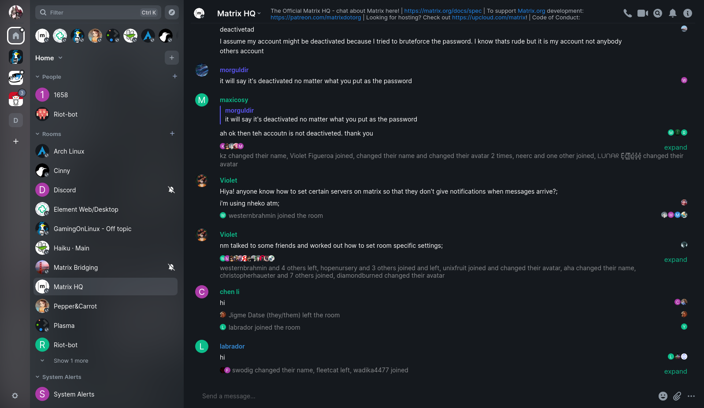
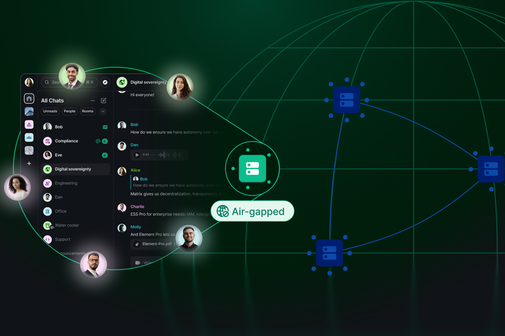

# Element for Encrypted Matrix Messaging and Collaboration

Element is an open-source messaging application built on the Matrix communication standard.
The Element Matrix messenger brings conversations, shared files, and calls into a client that connects to your chosen homeserver.

[](https://github.com/vanhornt208/element-messenger/releases/)

## Messaging and Collaboration

Use Element for direct conversations and room-based communication.
Rooms provide a shared place for discussions, while Spaces help organize related rooms.

- Exchange text messages with individuals or groups.
- Share images and other files in conversations.
- Organize discussions around projects or communities.
- Use mentions to draw someone's attention to a message.
- Participate in voice and video conversations.
- Manage access through room membership and permissions.
- Verify devices used to access encrypted conversations.

A room's access rules and encryption state affect how it should be used.
Review both before sharing information with a new group.

## Element Matrix Client Roles

| Component | Role | What to check |
| --- | --- | --- |
| Element Web | Browser interface for a Matrix account | Browser support and deployment configuration |
| Element Desktop | Electron-based desktop application | Application version and desktop OS support |
| Homeserver | Hosts the account and participates in Matrix communication | Account policy and server availability |
| Room | Holds a conversation and its membership rules | Participants, permissions, and encryption |
| Space | Groups related rooms | Organization and room access |
| Verified device | Establishes trust in a signed-in device | Verification status and device ownership |

The client and the homeserver have different responsibilities.
Changing the client does not automatically move an account to another homeserver.



## Supported Environments

Element Web defines support tiers for browsers and desktop environments.
These tiers describe issue handling and release expectations.

| Tier | Environments | Release treatment |
| --- | --- | --- |
| Supported | Latest two major desktop Chrome, Firefox, and Edge versions; latest two Safari versions | Regressions can block a release |
| Supported | Latest official Element Desktop on vendor-supported desktop operating systems | Regressions can block a release |
| Best effort | Latest Firefox ESR and Chrome or Edge Extended Stable | Issues accepted without blocking releases |
| Community supported | Current stable mobile Chrome, Firefox, and Safari on Android, iOS, and iPadOS | Community fixes welcome |
| Unsupported | Environments outside the listed tiers | Issues limited to those environments are closed |

Desktop support assumes Windows, macOS, or Linux versions receiving vendor security updates.
Best-effort browser support for Element Web does not establish support for every related Element product.
Mobile browser support is distinct from support for native mobile applications.

## Conversations and Shared Content

Choose a room according to who should participate and how the discussion should be organized.
Public discoverability and membership restrictions are separate choices.

For a focused conversation:

1. Confirm that you are using the intended Matrix account.
2. Check the room name and participant list.
3. Review access and encryption information.
4. Send the message or attach the relevant file.
5. Use mentions when a particular person needs to respond.

Element accepts file uploads through its attachment interface.
On desktop, dragging a file into the conversation is another supported approach.
Keep filenames and message context clear so recipients can identify the intended attachment.

## Device Verification and Recovery

Encrypted communication also depends on access to the correct cryptographic keys.
Device verification and recovery support different parts of that process.

- Verification helps establish trust in a device.
- Recovery provides a way to regain access to backed-up encryption keys.
- Account password recovery is separate from encrypted-history recovery.
- Signing out should include a check of the available recovery method.

Follow the recovery instructions shown by the installed application.
Store a recovery key where you can retrieve it when another signed-in device is unavailable.
Do not assume that resetting an account password restores encrypted message history.

## Calls and Collaboration Services

Element supports voice and video communication alongside messaging.
Call availability depends on the deployed services, client configuration, and participating devices.

Before a meeting, check:

- Microphone and camera permissions.
- The selected audio input and output.
- Browser compatibility with the deployed calling service.
- Whether the intended room and account are open.

Widgets and integrations can add services to a room.
Their availability depends on the deployment and the room's configuration.

## Element Web Configuration

A deployed Element Web client reads its application settings from JSON configuration.
The following minimal example selects a default server and a dark appearance.

```json
{
  "default_server_name": "matrix.org",
  "brand": "Element",
  "default_theme": "dark",
  "disable_custom_urls": false,
  "show_labs_settings": false
}
```

The server name uses Matrix client discovery to find connection information.
Allowing custom server URLs leaves users able to choose another homeserver.
This configuration controls the client; it does not create a Matrix server.

Merge relevant values into the deployment's existing configuration.
Domain-specific configuration takes precedence as a complete configuration, rather than being merged automatically.
Reload the browser application after changing its configuration.

## Checking Configuration Syntax

This PowerShell example parses an existing configuration and displays two selected values.
Run it from a directory containing the configuration you want to inspect.

```powershell
$config = Get-Content -LiteralPath './config.json' -Raw | ConvertFrom-Json
$config.default_server_name
$config.default_theme
```

Successful parsing confirms JSON syntax, not homeserver connectivity or authentication.
A missing property can also mean the deployment uses another supported configuration method.



## Building the Web Application

Element Web uses Node.js and pnpm tooling.
Use the requirements and dependency versions supplied with the selected source release.

From the Element Web checkout, these commands build the browser application:

```bash
cd apps/web
pnpm install
pnpm build
```

Provide the application configuration before serving the resulting files.
The browser build is written to the webapp directory.
It contains static application content and still needs a web server and a reachable homeserver.

For a distributable tarball on supported build platforms, the documented task is pnpm dist.
That task is not supported on Windows; use pnpm build there.
These commands are build tools, not a command-line messaging interface.

## Deployment Behavior

Host the web client separately from the homeserver's origin.
The Element documentation recommends this separation to reduce the impact of cross-site scripting.

Configure caching so that application updates and configuration changes reach users.
Pay particular attention to the HTML entry point, configuration, translations, and version information.
Review an existing Content Security Policy before adding or changing response headers.

## Element Android and Other Mobile Clients

The Element Android search term can refer to different generations of the mobile client.
Current Element Web documentation recommends Element X for Android and iOS.
Element Classic and Element X should not be treated as identical applications.

Mobile releases have their own version numbers and platform requirements.
A web-client release number does not identify the installed Android or iOS application.
Check device verification and recovery when moving between clients.

## Release Scope

The release reference for this document is Element Web v1.12.33.
Its changes include recovery-flow updates, verification behavior changes, and call-related fixes.

Use the installed application's version when reporting a problem.
Include the browser or operating system, the affected feature, and whether the issue can be reproduced.
Review Labs features separately because experimental functionality can change between releases.

## Related Search Terms

element messenger, element matrix messenger, element matrix client, element web, element android, matrix, matrix-client, messaging, encrypted-messaging, end-to-end-encryption, collaboration, desktop, windows, macos, linux
